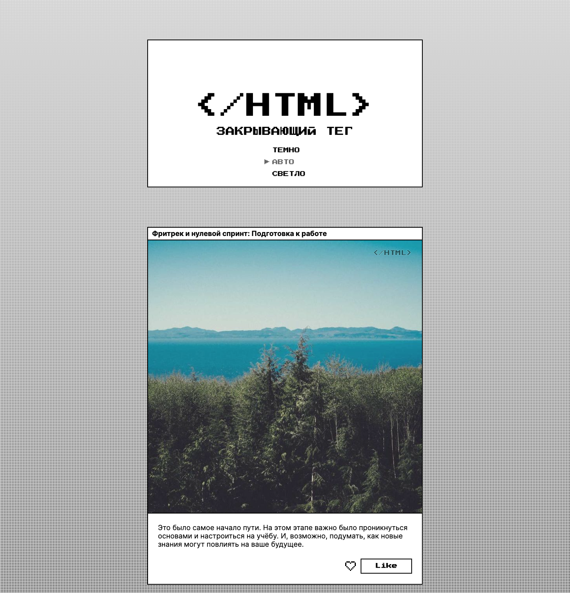
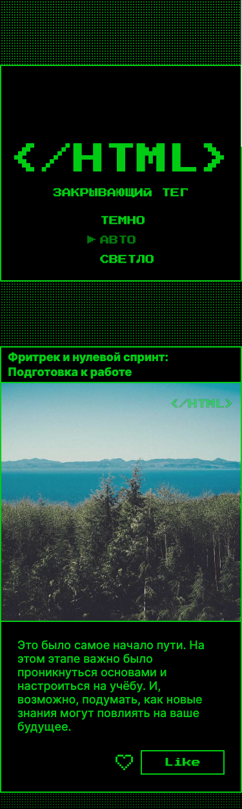

# Closing Tag

Closing Tag is a single-page learning journal about the stages of studying frontend development. Eight illustrated cards combine Russian course reflections with pixel-style typography, image effects, and interactive hearts.

This educational project follows an assignment and Figma design from **Yandex Practicum**. It demonstrates HTML, CSS, and vanilla JavaScript implementation using the course starter repository.

[View the Figma design](https://www.figma.com/design/UAfJrukDbpbtuxdctdBLJd/4-спринт.-Проектная-работа--Copy-?node-id=0-1)

[Github Pages](https://freakperry.github.io/zakrivayuschiy-teg-f/)

## Screenshots

Desktop at 1440 × 1500 (light theme) and mobile at 375 × 1250 (dark theme).

| Desktop | Mobile |
| --- | --- |
|  |  |

## Features

- Fluid layout with shared header and card widths, square images, and mobile overrides at 375px and below.
- Light, dark, and automatic themes. Automatic mode follows the system color preference; the selected mode is stored in `localStorage`.
- Like and unlike actions through either the heart icon or its text button, with synchronized labels and `aria-pressed` states. Likes reset on page reload.
- Layered heart animations, sparks, button hover overlays, and focus styles. A reduced-motion media query disables decorative animations.
- A native modal opened by the “Сохранить на память” button and closed through its OK form. This is a demonstration dialog; it does not save or download a file.
- Eight different local photographs with individual CSS filters.

## Technologies and implementation

The project uses semantic HTML, plain CSS, vanilla JavaScript, and SVG. It has no framework, package dependencies, or build step.

CSS Grid and Flexbox handle layout. Custom properties in `styles/variables.css` define colors, fonts, weights, and the layered gradient background. Typography uses locally hosted variable Inter and PressStart2P fonts.

Each inline heart separates its core, body, contour, and sparks so CSS can animate them independently. The floppy disk is a reusable external SVG symbol. Button text uses difference blending; image labels combine hard-light blending with text outlines and a shadow fallback.

## Run locally

Install Python 3, then run this command from the repository root:

```sh
python3 -m http.server 8000 --bind 127.0.0.1
```

Open [http://127.0.0.1:8000](http://127.0.0.1:8000). Stop the server with `Ctrl+C`. Serve the project over HTTP so the external SVG symbol can load.

## Credits

The assignment, design, and starter code come from Yandex Practicum. The heart SVG is based on the supplied Figma design; the site icons were created for this project.

Photographs come from Lorem Picsum, using image IDs 10, 29, 16, 28, 17, 13, 15, and 19. These neutral landscapes replace the repeated vehicle image in the reference design. Images and fonts are stored locally.
